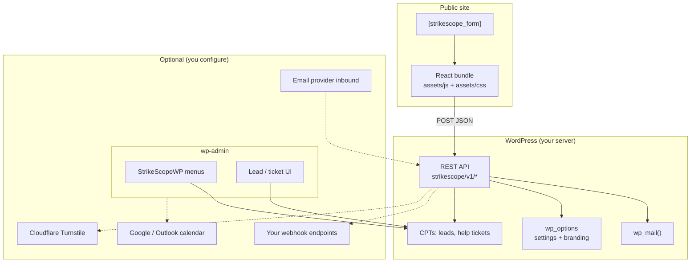
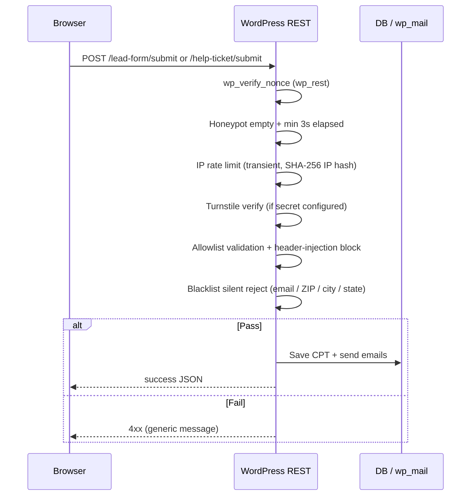
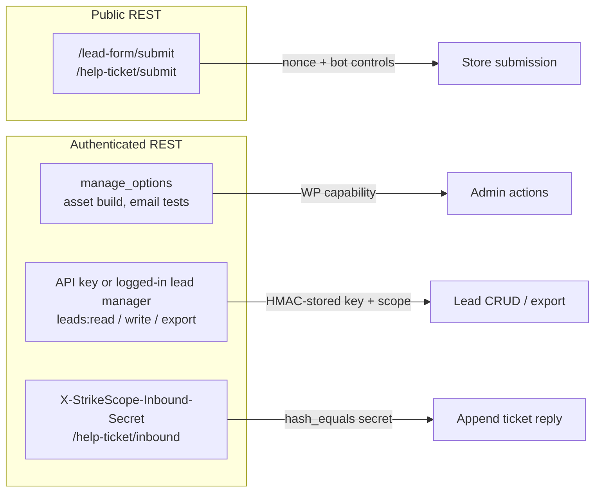
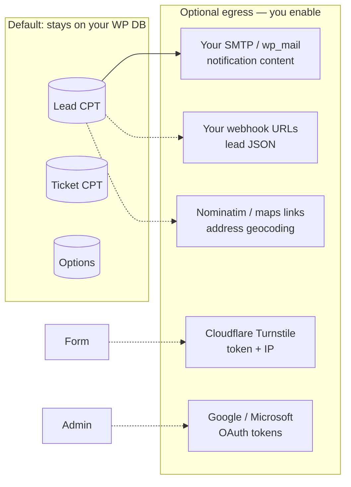

# StrikeScopeWP

WordPress plugin for contractor sites: multi-step lead forms, lightweight CRM, Help Desk, branded emails, scheduling hooks, and optional REST/webhooks.

[](LICENSE)
[](https://wordpress.org/)
[](https://www.php.net/)

## At a glance

| Area | What you get |
|------|----------------|
| **Public form** | React multi-step quote flow + optional Help Desk tab via `[strikescope_form]` |
| **CRM** | Lead custom post type, statuses, map dashboard, CSV export, sales-agent assignment |
| **Help Desk** | Ticket CPT, threaded email, status templates, inbound email webhook |
| **Branding** | Logo, form colors, phone, contact slug, footer — one source of truth for UI + emails |
| **Comms** | Per-service notification routing, customer follow-up, merge tags |
| **Integrations** | Turnstile, Google/Outlook calendar OAuth, scoped API keys, signed outbound webhooks (all optional) |

Data stays in your WordPress database unless you configure third-party services. The plugin does **not** phone home to the author or send telemetry.

---

## Architecture



### Public submission path

Both **lead** and **help-ticket** submissions use the same layered checks before anything is stored.



### Admin vs integration access



---

## Features

### Lead form & CRM

- **Multi-step React form** — service type, property, timeline, budget, contact/address; US-wide (no third-party parcel lookup).
- **Shortcode mount** — `[strikescope_form]` on any page; auto-mount when the page slug matches **Branding → contact page slug**.
- **Lead CPT** — each submission becomes a lead record with meta (services, contact, geo hash, assignment, status).
- **Admin list & detail** — filters, status workflow, internal notes, map view for geocoded leads.
- **CSV export** — admin or scoped API (`leads:export`).
- **Sales agents** — dedicated `strikescope_sales_agent` role; agents see only leads assigned to them (admins see all).
- **Blacklist** — admin-defined email, ZIP, city, and state lists; matches fail with a generic validation error (no leak to submitter).

### Help Desk

- **Second tab on the same form** — ticket category, priority, description (when enabled in settings).
- **Ticket numbering & statuses** — admin workflow with email notifications per status.
- **Threaded email** — reply tokens tie customer email threads back to tickets.
- **Inbound webhook** — `POST /strikescope/v1/help-ticket/inbound` for Postmark-style providers; requires `X-StrikeScope-Inbound-Secret` (constant-time compare).

### Branding & emails

- **StrikeScopeWP → Branding** — company name, logo URL, primary/accent/background colors, phone display, contact page slug, footer text.
- **Form theming** — colors flow to the React bundle via localized CSS variables (no hard-coded client palette in shipped assets).
- **Merge tags** — `%%COMPANY_NAME%%`, `%%PHONE%%`, `%%LOGO_URL%%`, lead/ticket fields, etc., in HTML templates under `templates/emails/`.
- **Per-service routing** — route notification emails by service type; customer follow-up template after lead submit.

### Scheduler & integrations

- **Calendar OAuth** — optional Google / Microsoft Outlook connection for availability-style workflows (admin-only REST).
- **REST API keys** — prefixed keys (`spk_…`); only **HMAC-SHA256 hashes** (keyed with `wp_salt('auth')`) stored in the database; scopes: `leads:read`, `leads:write`, `leads:export`.
- **Outbound webhooks** — JSON POST on events (`lead.created`, `lead.assigned`, etc.); optional `X-StrikeScope-Signature: sha256=<hmac>` when a webhook secret is set.
- **Cloudflare Turnstile** — optional; when a secret key is set, submissions without a valid token are rejected server-side.

### Privacy & compliance hooks

- WordPress **personal data exporters** for leads and help tickets (by email).
- WordPress **personal data eraser** for leads.
- Raw client IP is not stored in lead meta; a **SHA-256 hash** of `REMOTE_ADDR` is kept for abuse forensics.

---

## Security (CyberSecurity specialist view)

This section describes **trust boundaries**, **controls**, and **residual risk** so security reviewers can assess deployment without reading every PHP file.

### Threat model (summary)

| Asset | Primary threats | Plugin response |
|-------|-----------------|-----------------|
| Lead/ticket PII in DB | Unauthorized read/write | WP capabilities, sales-agent scoping, API key scopes |
| Public form endpoints | Spam, credential stuffing, injection | Nonce, honeypot, timing, rate limit, Turnstile, validation |
| Admin / REST API | Key theft, privilege escalation | Hashed API keys, scope checks, `manage_options` for sensitive routes |
| Email / webhooks | Header injection, forged inbound | CRLF checks on fields; inbound shared secret + `hash_equals` |
| Distribution artifact | Secrets or client data in zip | CI forbidden-pattern scan on push/PR and release |

**Out of scope for the plugin:** hardening your host OS, WAF, TLS termination, database encryption at rest, SMTP auth, or WordPress core/plugin CVEs — those remain site-operator responsibilities.

### Public attack surface

| Endpoint | Auth | Notes |
|----------|------|-------|
| `POST …/lead-form/submit` | WordPress REST nonce | Intentionally public; protected by bot/abuse layers |
| `POST …/help-ticket/submit` | Same | Disabled entirely when Help Desk is off (503) |
| `GET …/lead-form/assets` | — | Not a public write path; admin-only |

**Controls on public POST handlers**

1. **`wp_verify_nonce(…, 'wp_rest')`** — CSRF token tied to the localized script config.
2. **Honeypot field** (`website`) — bots that fill hidden fields get a generic 400.
3. **Minimum submit time (~3 seconds)** — reduces drive-by automated posts.
4. **Rate limiting** — per-IP counter in transients (`rate_limit_per_hour` setting); IP hashed with SHA-256 before use as transient key.
5. **Cloudflare Turnstile** — server-side `siteverify` when secret key is configured; skipped only when secret is empty (dev-friendly, not production-recommended).
6. **Strict allowlists** — service types, property types, timelines, budgets must match plugin enums (`sanitize_key` + `in_array`).
7. **Length limits & sanitization** — `sanitize_text_field`, email validation, max field lengths.
8. **Header injection guard** — rejects values containing `\r` or `\n` (email header smuggling).
9. **Blacklist** — silent reject for blocked email/ZIP/city/state (reduces attacker feedback).

**Residual public risks**

- Rate limits are **per WordPress instance** (transients), not global; high-volume attacks may need a WAF or edge rate limit.
- Client IP uses **`REMOTE_ADDR` only** — if you terminate TLS at a proxy, configure the server so WordPress sees the real client IP (or rate limits may target the proxy).
- Turnstile off + weak `rate_limit_per_hour` = higher spam volume (operational, not a bypass of auth).

### Authentication & authorization

| Mechanism | Implementation |
|-----------|----------------|
| wp-admin settings | `manage_options` (and lead caps for CRM screens) |
| Sales agent isolation | Custom caps + post meta `_lead_sales_agent`; list queries filtered for agents |
| REST API keys | Plain key shown once at creation; stored hash compared with **`hash_equals`** |
| API scopes | `leads:read`, `leads:write`, `leads:export` — enforced per route |
| Session fallback | Logged-in users with lead-manager capability bypass API key for same routes |
| Help Desk inbound | **`X-StrikeScope-Inbound-Secret`** compared with **`hash_equals`** to configured secret |
| Outbound webhooks | Optional **HMAC-SHA256** body signature header for receiver verification |

API keys are generated with **`random_bytes`**; prefix `spk_` aids log scanning without exposing full secrets.

### Data protection & third parties



- **No vendor telemetry** to StrikeScopeWP author servers.
- **Secrets** (Turnstile secret, OAuth client secrets, webhook HMAC secrets, inbound secret) live in **`wp_options`** — protect backups and DB access like any credential store.
- **Distribution CI** (`.github/workflows/distribution-check.yml`) blocks commits containing forbidden client-brand strings and common credential patterns; release workflow runs the same check before zipping.

### Security hardening checklist (operators)

1. **Production forms** — enable Turnstile; set a sensible `rate_limit_per_hour`; keep WordPress core and plugins patched.
2. **HTTPS everywhere** — REST nonces and cookies require TLS on the public site.
3. **API keys** — issue least-privilege scopes; revoke unused keys; never commit plain keys to git.
4. **Webhooks** — use HTTPS endpoints only; configure shared secret and verify `X-StrikeScope-Signature` on your receiver.
5. **Help Desk inbound** — rotate `inbound_secret` if leaked; restrict inbound route to provider IP ranges at the firewall when possible.
6. **Sales agents** — use the dedicated role instead of sharing administrator accounts.
7. **Backups** — encrypt backups containing `wp_options` and lead/ticket tables.
8. **File integrity** — install only from [GitHub Releases](https://github.com/GatoGodMode/strikescope-wp/releases) or your own `release.sh` / `release.ps1` build after CI passes.

### What this plugin does not provide

- SIEM, IDS, or centralized logging (use server/WP audit plugins).
- Field-level encryption at rest for PII.
- GDPR “data processing agreement” with third parties — you control which optional integrations are enabled.
- Guaranteed spam elimination — layered controls reduce abuse; human review may still be needed.

---

## Quick start

1. Install from **[Releases](https://github.com/GatoGodMode/strikescope-wp/releases)** (`strikescope-wp-x.x.x.zip`) or clone this repo and run `release.ps1` / `release.sh` after building assets.
2. **Plugins → Add New → Upload Plugin** → activate **StrikeScopeWP**.
3. Create a contact page with the shortcode:

   ```
   [strikescope_form]
   ```

4. **StrikeScopeWP → Branding** — company name, logo, colors, phone, contact page slug, footer text.
5. **StrikeScopeWP → Contact Form** — notification emails, Turnstile, services, Help Desk (Form tab shows branding-derived phone/slug as read-only with link to Branding).

## Configuration

| What | Where |
|------|--------|
| Logo, colors, phone, contact slug, footer | **StrikeScopeWP → Branding** |
| Notification emails, Turnstile, services, Help Desk | **StrikeScopeWP → Contact Form** |
| API keys, webhooks, calendar OAuth | **StrikeScopeWP → Integrations** / **API / Webhooks** |

Phone and contact page slug have a **single source of truth** in Branding (form, emails, scheduler links, auto-mount).

## Build from source

Requires **Node 20+** and **npm**.

```bash
# Build React bundle into assets/
./build-assets.sh          # Linux/macOS
./build-assets.ps1         # Windows PowerShell

# WordPress-ready zip (runtime files only — no frontend/ or node_modules/)
./release.sh
./release.ps1
```

## Releases & CI

| Workflow | Trigger | Purpose |
|----------|---------|---------|
| [Distribution check](.github/workflows/distribution-check.yml) | push, PR | Blocks client-brand leaks and credential patterns |
| [Release](.github/workflows/release.yml) | tag `v*` | Builds assets, runs scrub, uploads `strikescope-wp-{version}.zip` to GitHub Releases |

Tag a release:

```bash
git tag v1.0.0
git push origin v1.0.0
```

## Privacy

Lead and ticket data are stored locally. Optional calls may go to Cloudflare Turnstile, OpenStreetMap Nominatim (geocoding), Google Maps links, calendar providers, or webhooks you configure. See [readme.txt](readme.txt) for the WordPress.org privacy summary.

## Docs

- [Branding & merge tags](docs/BRANDING.md)
- [WordPress.org submission checklist](docs/WORDPRESS_ORG.md)
- [Changelog](CHANGELOG.md)

## Author

**uncooluser** — [WordPress.org profile](https://profiles.wordpress.org/uncooluser/)

## Support

[Buy Me a Coffee](https://buymeacoffee.com/josephedwards)

## License

[GPL-2.0-or-later](LICENSE)
